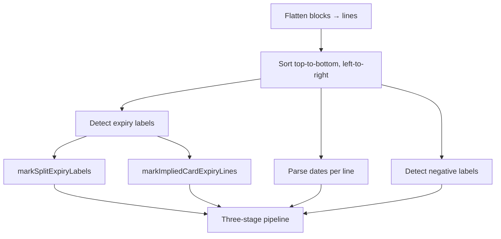

# Expiration Date Extraction

## Purpose

This document describes how the app extracts an **expiration date** from OCR text on identity documents (driver licenses, passports, state IDs, bank cards, Puerto Rico IDs, etc.).

The extractor lives in `src/expirationExtractor.ts` and is designed for output from **Google ML Kit Text Recognition** (`@react-native-ml-kit/text-recognition`). It takes the `blocks` array from OCR and returns a single best-guess expiration date, or `null` if none is plausible.

## End-to-end flow


### App integration

In `App.tsx`, the **ML Kit OCR** button runs recognition and then extraction:

1. User captures or selects an image (camera, gallery, or document scanner).
2. `TextRecognition.recognize(imageUri)` returns `{ text, blocks }`.
3. `extractExpirationDate(result.blocks)` produces the result.
4. The UI shows `display` (human-readable), `iso` (YYYY-MM-DD), `sourceLine`, and `strategy` for debugging.

Nitro OCR is available separately but is **not** wired to the expiration extractor; only ML Kit blocks include the line-level bounding boxes the spatial logic needs.

## Input format

ML Kit returns structured text with geometry:

| Field | Type | Used for |
|-------|------|----------|
| `blocks[].lines[].text` | `string` | Label matching, date parsing |
| `blocks[].lines[].frame` | `{ top?, left?, x?, y?, width?, height? }` | Spatial proximity (stage 2) |

Lines are flattened from all blocks and sorted **top-to-bottom**, then **left-to-right** when vertical positions are similar.

## Output format

`extractExpirationDate` returns an `ExpirationExtraction`:

| Field | Type | Description |
|-------|------|-------------|
| `date` | `ParsedDate \| null` | Structured `{ year, month, day, raw }` |
| `iso` | `string \| null` | ISO date `YYYY-MM-DD` |
| `display` | `string \| null` | UI-friendly string (see formatting below) |
| `sourceLine` | `string \| null` | OCR line the winning date came from |
| `strategy` | enum | How the date was found (see strategies) |

### Strategy values

| Strategy | Meaning |
|----------|---------|
| `label-same-line` | Expiry label and date on the same OCR line (e.g. `EXP 12/05/2027`) |
| `label-nearby` | Expiry label on one line, date on the closest nearby line |
| `fallback-score` | No reliable label match; best date chosen by scoring heuristics |
| `none` | No plausible expiration date found |

## Pre-processing: line analysis

Before any stage runs, every OCR line is classified and enriched:



| Step | Function | What it does |
|------|----------|--------------|
| Line ordering | `getMlKitLinesTopToBottom` | Flattens all blocks into one list sorted by `frame.top` (or `y`), then `frame.left` (or `x`) |
| Date parsing | `findDatesInText` | Runs OCR normalization, then extracts all date-shaped tokens from the line |
| Expiry labels | `isExpiryLabel` | True if the line matches any pattern in `EXPIRY_LABEL_REGEXES` |
| Negative labels | `isNegativeLabel` | True if the line matches DOB, issue date, or “valid from” patterns |
| Split labels | `markSplitExpiryLabels` | When OCR splits `VALID THRU` across two nearby lines (&lt; 40px apart), both lines are marked as expiry |
| Implied card expiry | `markImpliedCardExpiryLines` | On bank cards only, lines like `%01/09` or bare `12/27` are treated as expiry lines |

### Bank card context

Implied expiry detection only runs when the document looks like a payment card:

- Card network keywords: `visa`, `mastercard`, `amex`, `discover`, `debit`, `credit card`, `reliacard`
- Or a 15–16 digit card number pattern (groups of 3–4 digits)

This avoids treating random numeric fragments on IDs as expiry labels.

## Three-stage extraction pipeline

The extractor tries strategies in order and returns on the first successful match.

### Stage 1 — Label on the same line

For each line that contains an **expiry label** and at least one **parseable date**:

1. Prefer dates that appear **after** the expiry label in the line (e.g. `DOB 01/15/1990 EXP 12/05/2027` → pick the date after `EXP`).
2. Skip dates that are implausible as expirations (>25 years in the future, >100 years in the past).
3. Score remaining candidates and pick the highest.

**Example:** `EXP 12/05/2027` → `2027-12-05`, strategy `label-same-line`.

### Stage 2 — Label on a separate line

When the label is alone (e.g. `EXPIRES` on one line, `12-05-2027` on the next):

1. Find other lines with dates that are spatially close to the label line.
2. **Same row, to the right** (vertical distance &lt; 30px, date line is further right) is preferred — common on US driver licenses with column layouts.
3. Otherwise, lines within ~150px vertically are considered (e.g. date on the line below).
4. Among candidates, score dates and prefer the best.
5. **Tie-break** (`isBetterDateCandidate`): higher score wins; on equal score, prefer a full `M/D/Y` numeric date over short `M/Y`, then prefer the later calendar date.

**Example:** Passport with `Date of expiry:` on line 6 and `12 DEC 2027` on line 7 → `2027-12-12`, strategy `label-nearby`.

### Stage 3 — Fallback scoring

If stages 1 and 2 find nothing, every date in the document is scored. The highest-scoring plausible date wins.

This handles documents with no clear label or heavily mangled OCR, but is less reliable than label-guided extraction.

## Date parsing

### Supported formats

| Format | Example | Notes |
|--------|---------|-------|
| Numeric full | `12/05/2027`, `12-05-2027`, `12.05.2027` | M/D/Y or D/M/Y as written in OCR |
| Numeric short | `12/27`, `01/30` | Month/year only; day defaults to **1** |
| Alpha month first | `DEC 12 2027`, `12 DEC 2027` | Requires 4-digit year and clear separators |
| Day month year | `15 JAN 1990` | |
| Compact alpha | `14NOV2014`, `12DIC2011` | Common on Puerto Rico IDs |

### Century handling

Two-digit years: `≥ 70` → 1900s, `< 70` → 2000s (e.g. `12/05/27` → 2027).

### Month names

English full and abbreviated names, plus Spanish abbreviations used on Latin American / Puerto Rico IDs (`ene`, `abr`, `ago`, `dic`, etc.).

### OCR normalization

Before regex matching, `normalizeOcrForDateParsing` fixes common ML Kit misreads:

- Merged slashes: `0504/2027` → `05/04/2027`
- Zero for letter O in months: `0CT` → `OCT`
- Spurious digits: `01112/2022` → `01/12/2022`
- Slash read as `l` or `I`: `06/15l2016` → `06/15/2016`
- Label glued to date: `EXP01/06/2024` → `EXP 01/06/2024`
- `ExpQ7/22/2033` → `Exp 07/22/2033`
- Dropped slash + truncated year: `01/07203` → `01/07/2030` (OCR loses the final year digit)

### False-positive guards

The parser deliberately **rejects** many OCR artifacts:

- `DEC 2027` without a day (would false-match as `DEC 20 27`)
- Short `M/Y` before `=YYYY` (e.g. `Ô2-01=1971`)
- `M/Y` before another numeric segment (customer ID patterns like `11-087-0`)
- 3-digit year fragments from ID numbers
- Invalid months/days or years outside 1900–2200

## Label detection

### Expiry labels (`EXPIRY_LABEL_REGEXES`)

Lines matching these patterns are treated as expiration indicators:

- `expiration`, `expiry`, `exp date`, `date of expiry`
- `valid thru`, `good thru`, `valid until`
- `card expires`, `expires`
- Abbreviations and OCR variants: `EXP`, `eD`, `4b exp`, `exp.` before digits
- Mangled labels: `exiration dat`, `dats of expirat`, `date oxp`

Multi-word patterns are listed first so they win over bare `EXP`.

### Same-line date position

When a line has both a label and multiple dates (e.g. `DOB 01/15/1990 EXP 12/05/2027`), `getExpiryMarkerEnd` finds where the expiry label ends in the string. Dates **after** that position are preferred via `isDateAfterExpiryMarker`, so the DOB is ignored in favor of the expiration date.

### Implied card expiry lines

When bank card context is detected, these patterns count as expiry labels even without the word “EXP”:

| Pattern | Example | Why |
|---------|---------|-----|
| Leading symbols + M/Y | `%01/09` | OCR often drops `VALID THRU` and leaves a `%` or similar glyph |
| `thru` / `valid` + M/Y | `thru 12/27` | Partial label retention |

### Split `VALID THRU` labels

OCR sometimes puts `VALID` on one line and `THRU` on the next. `isValidThruSplitPair` detects this when the two lines are within 40px vertically and one token is `valid`/`good` while the other is `thru`/`through`. Both lines are then treated as expiry labels for stage 2 proximity search.

### Negative labels (`NEGATIVE_LABEL_REGEXES`)

Lines marked as **not** expiration context:

- Date of birth: `DOB`, `born`, `birth date`
- Issue date: `issued`, `issue date`, `iss`, `4a`, `cae date` (Spanish *fecha de emisión*)
- Valid from: `from`, `valid from`

Negative labels **penalize** nearby dates in scoring (−60) so issue dates and DOBs are less likely to be chosen as expiration.

### Spatial negative alignment

In stage 2, a date line is also penalized if it is horizontally aligned under a negative label (e.g. issue date in the left column) rather than under the expiry label.

## Scoring heuristics

`scoreDateCandidate` combines temporal and contextual signals:

| Signal | Score impact |
|--------|--------------|
| Future date, 0–12 years out | +50 |
| Future date, 12–25 years out | +20 |
| Past date, within 1 year | +5 |
| Past date, more than 1 year ago | −30 |
| Near expiry label | +80 |
| Near negative label | −60 |

Dates more than **25 years** in the future or **100 years** in the past are excluded entirely (`isLikelyNotExpiration`), reflecting typical document lifetimes (cards ~5y, licenses 4–8y, passports ~10y).

A candidate must have **score &gt; 0** to be accepted.

## Display formatting

- **`iso`**: Always `YYYY-MM-DD` (zero-padded month/day).
- **`display`**: If the raw match contains an alpha month (`DEC`, `NOV`, etc.), shows `DD/MM/YYYY`. Otherwise keeps the original OCR numeric string (e.g. `02-01-2013`).

## Examples by document type

| Document | OCR line | Result | Strategy |
|----------|----------|--------|----------|
| US driver license | `EXP 12/05/2027` | `2027-12-05` | `label-same-line` |
| Passport | `Date of expiry: 12 DEC 2027` | `2027-12-12` | `label-same-line` |
| Bank card | `VALID THRU 12/27` | `2027-12-01` | `label-same-line` |
| ReliaCard (device OCR) | `%01/09` (no label text) | `2009-01-01` | `label-same-line` |
| State ID | `EXPIRES` + `12-05-2027` (next line) | `2027-12-05` | `label-nearby` |
| Green card | `Card Expires: 12/05/27` | `2027-12-05` | `label-same-line` |
| Nebraska ID (noisy OCR) | `3 DOB Ô2-01=1971Ee EXP 02-01-2013` | `2013-02-01` | `label-same-line` |
| PR ID | `O EXP 14NOV2014` | `2014-11-14` | `label-same-line` |
| Birth cert only | `DOB 01/15/1990` | `null` | `none` |
| Far-future typo | `Date of expiry: 12 DEC 2099` | `null` | `none` |

## Public API surface

Key exports from `src/expirationExtractor.ts`:

| Export | Role |
|--------|------|
| `extractExpirationDate(blocks)` | Main entry point |
| `findDatesInText(text)` | Parse all dates from a string (used internally and in tests) |
| `isExpiryLabel(text)` | Check if text contains an expiry label |
| `isNegativeLabel(text)` | Check if text contains a DOB/issue label |
| `isImpliedCardExpiryLine(text)` | Detect bare `MM/YY` lines that imply card expiry |
| `isValidThruSplitPair(a, b)` | Detect `VALID` + `THRU` split across two OCR lines |
| `getExpiryMarkerEnd(text)` | Index after the last expiry label match in a line |
| `isDateAfterExpiryMarker(text, raw)` | Whether a parsed date appears after the expiry label |
| `normalizeOcrForDateParsing(text)` | OCR cleanup before parsing |
| `getMlKitLinesTopToBottom(blocks)` | Flatten and sort ML Kit lines |
| `formatIso` / `formatDisplay` | Output formatting |

## Testing

Unit tests in `__tests__/expirationExtractor.test.tsx` cover:

- Standard US document patterns (license, passport, card, state ID)
- Label vs. DOB preference
- Fallback scoring when no label exists
- Real device OCR regressions (VA, MO, LA, Nebraska, Illinois, Puerto Rico, passport)
- OCR normalization edge cases

Run tests from the project root:

```bash
yarn test expirationExtractor
```

## Limitations

- **ML Kit only**: Requires ML Kit `blocks` with `frame` geometry; plain text OCR without positions loses stage 2 accuracy.
- **English / Spanish labels**: Optimized for US and Puerto Rico document wording; other locales may need additional regexes.
- **Ambiguous numeric dates**: `01/02/2027` is parsed as month=1, day=2 (US-style assumption in the regex order).
- **Short M/Y**: Bank card `12/27` is stored as the 1st of the month, not the last day of the month.
- **No confidence scores**: ML Kit line confidence is not used; selection is rule- and heuristic-based.
- **Single date output**: Returns one expiration date per image, not multiple candidates.

## Related files

- `src/expirationExtractor.ts` — core logic
- `App.tsx` — ML Kit OCR trigger and UI (`recognizeWithMLKit`)
- `__tests__/expirationExtractor.test.tsx` — behavior and regression tests
