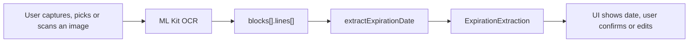

# Expiration Date Extraction

## Purpose

This document describes how the app extracts an **expiration date** from OCR text on any document a user uploads: ID cards (including Pakistani CNICs), driving licences, passports, bank cards, permits, certificates, receipts and so on.

The extractor lives in `src/expirationExtractor.ts` and is designed for output from **Google ML Kit Text Recognition** (`@react-native-ml-kit/text-recognition`). It takes the `blocks` array from OCR and returns one expiration date, a "never expires" result, or `null` when the document has no expiry date.

One extractor handles every country. It works out from the document itself whether numeric dates are day-first (`15/03/2030`) or month-first (`03/15/2030`). There is no regional setting.

## End-to-end flow



### App integration

In `App.tsx`:

1. The user captures a photo, picks one from the gallery, or scans a document.
2. OCR runs straight away: `TextRecognition.recognize(imageUri)` returns `{ text, blocks }`.
3. `extractExpirationDate(result.blocks)` produces the result.
4. The UI shows the date with how long it is valid for (or how long ago it expired) and asks the user to confirm it. When the date is `ambiguous`, both readings are shown as buttons. When nothing is found, the user can type the date.
5. In development builds a grey debug line shows `strategy`, `confidence`, the detected date order and the source line.

## Input format

| Field | Type | Used for |
|-------|------|----------|
| `blocks[].lines[].text` | `string` | Label matching, date parsing |
| `blocks[].lines[].frame` | `{ top?, left?, x?, y?, width?, height? }` | Matching labels to values on the page |

Lines are flattened from all blocks and sorted **top-to-bottom**, then **left-to-right**.

Distances between lines are measured in **line units**: the median `frame.height` of the lines. This makes results independent of photo resolution. Without heights the unit falls back to 30px.

## Output format

`extractExpirationDate(blocks, options?)` returns an `ExpirationExtraction`:

| Field | Type | Description |
|-------|------|-------------|
| `date` | `ParsedDate \| null` | `{ year, month, day, raw, precision, ambiguous, alternative? }` |
| `iso` | `string \| null` | `YYYY-MM-DD`. Null when no date was found or the document never expires |
| `display` | `string \| null` | `05 Mar 2036`, `Dec 2027` (month/year dates) or `Lifetime` |
| `sourceLine` | `string \| null` | OCR line the result came from |
| `strategy` | enum | How it was found (see below) |
| `confidence` | `'high' \| 'medium' \| 'low' \| null` | `high`: MRZ or a label on the same line; `medium`: a nearby label; `low`: no label |
| `noExpiry` | `boolean` | The document says it never expires (`LIFETIME`, `UNLIMITED`, ...) |
| `ambiguous` | `boolean` | The date could also be read the other way round. Ask the user |
| `alternativeIso` | `string \| null` | The other reading of an ambiguous date |
| `dateOrder` | `'DMY' \| 'MDY'` | Order used for numeric dates on this document |
| `dateOrderSource` | `'evidence' \| 'country' \| 'default' \| 'option'` | Why that order was chosen |

`options`:

| Option | Default | Description |
|--------|---------|-------------|
| `now` | current date | Reference "today". Tests pass a fixed date |
| `dateOrder` | detected | Force `'DMY'` or `'MDY'`. Normally leave unset |

### Strategy values

| Strategy | Meaning |
|----------|---------|
| `mrz` | Read from a passport / ID machine-readable zone, check digits verified |
| `label-same-line` | Expiry label and date on the same OCR line (e.g. `EXP 12/05/2027`) |
| `lifetime` | The expiry field says the document never expires |
| `label-nearby` | Expiry label on one line, its value on a nearby line |
| `fallback-score` | No label: the best future date on an unlabelled line |
| `none` | No expiry date (typical for receipts and certificates) |

## Day-first or month-first

Numeric dates like `05/03/2030` can mean 5 March or May 3. The order is decided once per document:

1. **Evidence.** If another numeric date on the document has a first part above 12 (`DOB 25/04/1990`), the document is day-first. If the second part is above 12 (`DOB 04/25/1990`), it is month-first. The majority wins.
2. **Country words.** `PAKISTAN`, `NADRA`, `UNITED KINGDOM`, `INDIA`, `UAE`, the British spelling `LICENCE` and other day-first countries mean day-first. `USA`, `UNITED STATES`, `DRIVER LICENSE`, `STATE OF ...`, `PERMANENT RESIDENT` or any US state name mean month-first. If both kinds appear, this step is skipped.
3. **Default.** Day-first, which most of the world uses. Dates read this way are returned with `ambiguous: true` and the other reading in `alternativeIso`.

A date that can only be read one way (`25/12/2030`) is never ambiguous, whatever the document order. A date like `05/05/2030` is the same either way and isn't ambiguous either.

## Extraction pipeline

The extractor tries these stages in order and returns the first result.

### 1. MRZ

Passports (TD3), visas (TD2) and many ID cards (TD1) carry a machine-readable zone. In all three, the birth date, its check digit, the sex and the expiry date with its check digit sit next to each other. The extractor accepts the expiry date only when **both** check digits are correct (ICAO 9303, weights 7-3-1), which makes it the most reliable source. OCR spaces are removed and `O`/`I` are read as `0`/`1`.

### 2. Label on the same line

For each line with an expiry label and a date:

1. Each date belongs to the label just before it. In `ISS 01/03/2026 EXP 31/03/2036` the first date belongs to `ISS` and the second to `EXP`, so the expiry date is chosen.
2. A date before any label is only used when the line has no issue or birth label (e.g. `%01/09` on a bank card).
3. Dates more than 25 years ahead or 100 years back are skipped.
4. For ranges (`Validity: 01/01/2025 - 31/12/2026`) the later date wins.

### 3. Lifetime on the label line

`Date of Expiry: LIFETIME` returns `noExpiry: true`. Accepted words: lifetime, life time, unlimited, indefinite, no expiry, non-expiring, does not expire, never expires, vitalicio, illimité, unbefristet. "Permanent" only counts directly after an expiry label, so `Permanent Address` and `Permanent Resident Card` are not mistaken for it.

### 4. Label on a separate line

Common on CNICs and passports, where labels and values are in columns:

```
Date of Issue      Date of Expiry
15.03.2026         15.03.2036
```

Every value line (a line with a date or a lifetime word and no label of its own) is assigned to its **closest label**:

- same row, to the right of the label: strongly preferred
- below the label, within 5 line units: distance plus half the horizontal offset
- above the label: allowed but penalised

A value assigned to an issue or birth label is never used, so the issue date can't be returned as the expiry date. Among values assigned to expiry labels, the closest wins. If it says `LIFETIME`, the result is `noExpiry`.

### 5. Fallback

When no label works, only a **future** date (up to 25 years ahead) on an unlabelled line is accepted, with `confidence: 'low'`. Month/year fragments are only used on bank cards. This is why receipts and certificates, which carry past dates, return `none`.

## Date parsing

### Supported formats

| Format | Examples | Notes |
|--------|----------|-------|
| Year first | `2030-03-15`, `2030/03/15`, `2030.03.15` | Always year-month-day |
| Numeric | `15/03/2030`, `03-15-2030`, `15.03.30` | Day/month order from the document (see above) |
| Day, month name, year | `15 MAR 2030`, `15-Mar-2030`, `15/MAR/30`, `5th June 2028`, `14NOV2014` | 2-digit years allowed |
| Bilingual month | `15 MAR /MARS 2030` | Passports |
| Month name, day, year | `Mar 15, 2030`, `DEC 12 2027` | 4-digit year required |
| Month/year numeric | `12/27`, `12/2027`, `12.2027` | Last day of the month. A dot needs a 4-digit year, so `2.50` is never a date |
| Month name and year | `June 2028`, `DEC 2027` | Last day of the month |
| MRZ | `...M3003150...` | See stage 1 |

### Century handling

Two-digit years: `≥ 70` → 1900s, `< 70` → 2000s (e.g. `12/05/27` → 2027). MRZ years are 2000s unless that is more than 50 years ahead.

### Month names

English, Spanish, Portuguese, French and German, full and abbreviated (`ene`, `abr`, `ago`, `dic`, `janv`, `févr`, `mars`, `mai`, `juil`, `août`, `märz`, `okt`, `dez`, ...).

### OCR normalization

Before matching, `normalizeOcrForDateParsing` fixes common ML Kit misreads:

- Unicode dashes and slashes → `-` and `/`
- Merged slashes: `0504/2027` → `05/04/2027`, `2504/2027` → `25/04/2027` (year ranges like `2012-2016` are left alone)
- Zero for letter O in months: `0CT` → `OCT`
- Spurious digits: `01112/2022` → `01/12/2022`
- Slash read as `l` or `I`: `06/15l2016` → `06/15/2016`
- Label glued to date: `EXP01/06/2024` → `EXP 01/06/2024`
- `ExpQ7/22/2033` → `Exp 07/22/2033`
- Dropped slash + truncated year: `01/07203` → `01/07/2030`

### False-positive guards

- Prices and times (`2.50`, `12.30`, `10.45`) are not dates
- `DEC 2027` is a month/year date, never `DEC 20 '27`
- Month/year before `=YYYY` (e.g. `Ô2-01=1971`) or before another number segment (`11-087-0`) is ignored
- 3-digit year fragments from ID numbers are rejected
- Days must exist in their month (no 31 April); years must be 1900–2200

## Label detection

### Expiry labels (`EXPIRY_LABEL_REGEXES`)

- `expiration`, `expiry`, `exp date`, `date of expiry`, `expires`, `card expires`
- `valid thru / through / until / till / to / upto`, `valid from ... to`, `validity`, `good thru`
- `best before`, `use by`, `renewal date`, `renew by`
- Spanish `vence`, `vencimiento`, `fecha de vencimiento`, `caducidad`; Portuguese `validade`, `vencimento`; French `valable jusqu'au`, `fin de validité`; German `gültig bis`, `Ablaufdatum`
- Licence field `4b` followed by a date (US and EU licences)
- Abbreviations and OCR variants: `EXP`, `eD`, `exp.` before digits, `exiration dat`, `dats of expirat`, `date oxp`

### Negative labels (`NEGATIVE_LABEL_REGEXES`)

- Birth: `DOB`, `D.O.B`, `date of birth`, `born`, `nacimiento`, `naissance`, `Geburtsdatum`
- Issue: `issued`, `issue date`, `date of issue`, `iss`, `4a`, `cae date`, `expedición`, `emisión`, `délivré`, `ausgestellt`
- Transactions and records: `invoice date`, `bill date`, `receipt date`, `order date`, `paid on`, `printed on`, `date of registration / admission / award / completion`
- A bare `Date:`, the transaction or issue date on receipts and certificates
- `from`, `valid from`

When a negative label is part of an expiry label (`Expiry Date:` contains `Date:`), the expiry label wins.

### Bank cards

Card context means a network keyword (`visa`, `mastercard`, `amex`, `discover`, `debit`, `credit card`, `unionpay`, `paypak`, `reliacard`) or a card-number pattern (16 digits in groups of 4, or Amex 4-6-5). With card context:

- bare `MM/YY` lines like `%01/09` count as expiry lines (OCR often drops `VALID THRU`)
- `VALID` and `THRU` split across two nearby lines (within 1.4 line units) are joined into one label

## Scoring

Used to choose between dates that belong to the same label:

| Signal | Score impact |
|--------|--------------|
| Future date, 0–12 years out | +50 |
| Future date, 12–25 years out | +20 |
| Past date, within 1 year | +5 |
| Past date, more than 1 year ago | −30 |
| Next to an expiry label | +80 |

Ties go to a full date over a month/year date, then to the later date.

## Examples by document type

Generated from the extractor with today set to 13 Oct 2026:

| Document | OCR lines | Result | Strategy |
|----------|-----------|--------|----------|
| US driver license | `DOB 01/15/1990` · `EXP 12/05/2027` | `2027-12-05` | `label-same-line` |
| Pakistani CNIC | `Date of Issue` / `Date of Expiry` side by side, `15.03.2026` / `15.03.2036` below | `2036-03-15` | `label-nearby` |
| Pakistani CNIC (lifetime) | same layout, `LIFETIME` under Date of Expiry | Never expires | `lifetime` |
| Passport (MRZ) | `AB12345671PAK9001011M3003150<<<<<<<<<<<<<<04` | `2030-03-15` | `mrz` |
| Passport (visual zone) | `Date of expiry` · `12 DEC 2027` on the next line | `2027-12-12` | `label-nearby` |
| UK / EU licence | `4b. 31.01.2030` | `2030-01-31` | `label-same-line` |
| Bank card | `VISA` · `VALID THRU 12/27` | `2027-12-31` | `label-same-line` |
| Insurance / permit | `Valid From 01/01/2026 To 31/12/2030` | `2030-12-31` | `label-same-line` |
| Food / medicine | `Best before 05/2027` | `2027-05-31` | `label-same-line` |
| No clue about order | `EXP 05/03/2030` alone | `2030-03-05` (ambiguous, alt `2030-05-03`) | `label-same-line` |
| Shop receipt | `Date: 12/10/2026` · `Total Rs. 12.30` | `null` | `none` |
| Degree certificate | `Session 2022-2026` · `Date: 20 March 2026` | `null` | `none` |

## Public API surface

Key exports from `src/expirationExtractor.ts`:

| Export | Role |
|--------|------|
| `extractExpirationDate(blocks, options?)` | Main entry point |
| `findDatesInText(text, dateOrder?)` | Parse all dates from a string; detects the order from the text when `dateOrder` is omitted |
| `detectDateOrder(lines)` | Day-first / month-first decision for a set of lines |
| `findMrzExpiryDate(lines, now?)` | Expiry date from MRZ lines (check digits verified) |
| `mrzCheckDigit(value)` | ICAO 9303 check digit |
| `isExpiryLabel(text)` / `isNegativeLabel(text)` | Label checks |
| `isImpliedCardExpiryLine(text)` | Detect bare `MM/YY` lines that imply card expiry |
| `isValidThruSplitPair(a, b)` | Detect `VALID` + `THRU` split across two OCR lines |
| `getExpiryMarkerEnd(text)` / `isDateAfterExpiryMarker(text, raw)` | Position of the expiry label in a line |
| `normalizeOcrForDateParsing(text)` | OCR cleanup before parsing |
| `getMlKitLinesTopToBottom(blocks)` | Flatten and sort ML Kit lines |
| `formatIso` / `formatDisplay` | Output formatting |

## Testing

Unit tests in `__tests__/expirationExtractor.test.tsx` cover:

- US documents (licence, passport, bank card, state ID, green card, ReliaCard device OCR)
- Day-first vs month-first detection (evidence, country words, default with `ambiguous`)
- CNIC column layouts, including issue dates that must not be picked
- Other formats (ISO, alpha months, month/year, bilingual passports, Spanish, German, EU licence `4b`)
- MRZ (TD3, TD1, OCR noise, wrong check digit)
- Lifetime documents and "Permanent Address"
- Documents with no expiry (receipts, certificates, prices)
- Resolution independence and nearest-label selection
- OCR normalization

Every test passes a fixed `now` (13 Oct 2026), so results don't change with the calendar.

```bash
yarn test expirationExtractor
```

## Limitations

- **ML Kit only.** Needs ML Kit `blocks` with `frame` geometry. Plain OCR text without positions only gets stages 1, 2, 3 and 5.
- **Latin script only.** ML Kit's Latin recogniser can't read Urdu or Arabic labels, so on bilingual documents only the English text is used.
- **Truly ambiguous dates.** With no evidence and no country words, `05/03/2030` is read day-first and flagged `ambiguous`. The app asks the user.
- **One date per image.** Documents with the expiry on the back need a second photo.
- **No PDFs.** The app accepts photos only.
- **No OCR confidence.** ML Kit line confidence is not used.
